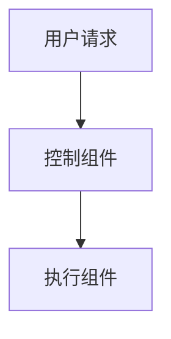

# <技术主题>

## 一、概述与设计初衷

### 是什么

<准确概念、职责、边界>

### 为什么设计它

<原先难题、设计目的、实际意义与取舍>

## 二、整体架构



<解释组件和箭头含义；用经过确认的实际架构替换示例>

## 三、核心概念与组件

| 组件/概念 | 职责 | 为什么需要 | 与其他组件关系 |
|---|---|---|---|
| <组件> | <职责> | <设计目的> | <调用链> |

## 四、工作原理与完整流程

1. <步骤与条件>
2. <步骤与交互>
3. <状态变化与结果>

## 五、实际使用

**适用环境：** <产品版本、操作系统、角色与必要条件>

**操作目的：** <简短解释>

```bash
# 仅放验证正确的命令；不留危险的示例占位命令
```

**验证方式：** <执行后应该观察到什么>

## 六、故障排查

| 故障现象 | 可能原因 | 如何验证 | 正确处理与复测 |
|---|---|---|---|
| <症状> | <假设> | <可观察的证据> | <解决和复验> |

## 七、常见误区与注意事项

- <用正确概念纠正易混淆认识>

## 八、知识总结

<关键知识关系与实践意义>
